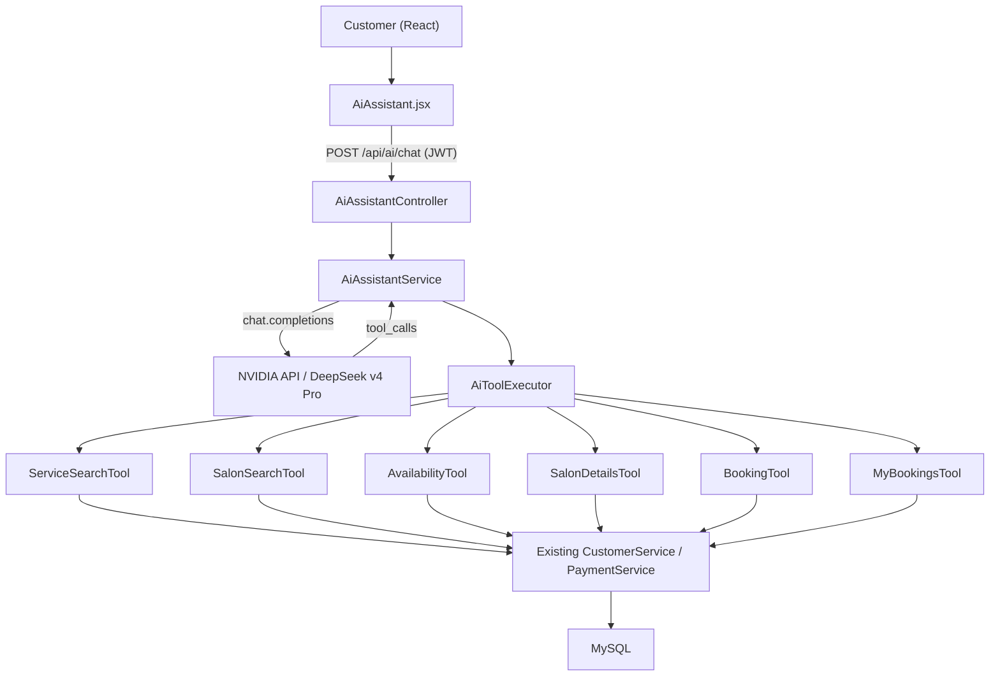

# Salon Luxe

A modern salon marketplace and appointment booking platform with an AI-powered appointment assistant.

## Tech Stack

### Backend
- Java 21, Spring Boot 3.3.4, Spring MVC, Spring Data JPA / Hibernate
- Spring Security with JWT authentication
- MySQL, Maven
- Razorpay payment integration

### Frontend
- React 19, Vite 8, Tailwind CSS 4, Axios, Lucide React icons

---

## AI Appointment Assistant

### Why AI Was Added

The AI Appointment Assistant provides a conversational interface for customers to discover salon services, check availability, and book appointments using natural language instead of navigating through multiple pages. Customers can say things like "I need a haircut tomorrow evening" and the assistant handles the rest.

### Architecture

The LLM never directly accesses MySQL or modifies application state. All operations go through existing validated, transactional Spring Boot services.

```
Customer → React AI Chat UI → Spring Boot AI Controller → AI Assistant Service
→ LLM API (NVIDIA/DeepSeek) → Tool/Function Call → Existing Spring Boot Business Services
→ Repositories → MySQL
```

**Principle: AI suggests. Backend validates and decides.**



### LLM Integration

- **Provider**: NVIDIA API (`https://integrate.api.nvidia.com/v1`)
- **Model**: DeepSeek v4 Pro (`deepseek-ai/deepseek-v4-pro-0813`)
- **Protocol**: OpenAI-compatible chat completions API with function calling
- **Tool Loop**: The service supports multi-round tool calling — the LLM can call multiple tools before generating a final response

### Available AI Tools

| Tool | Purpose | Reuses |
|------|---------|--------|
| `searchServices` | Find salon services by keyword | `ServiceRepository` |
| `searchSalons` | Find salons by name, rating, budget, service type | `CustomerService.getAllShops()` |
| `getAvailableSlots` | Check available time slots for a salon on a date | `SlotRepository` |
| `getSalonDetails` | Get detailed salon info with services | `CustomerService.getShopDetails()` |
| `createBooking` | Create an appointment booking | `CustomerService.bookSlot()` |
| `getMyBookings` | View customer's existing bookings | `CustomerService.getMyBookings()` |

### Booking Confirmation Flow

1. Customer requests a service (e.g., "I need a haircut tomorrow evening")
2. AI searches for matching services and salons
3. AI checks availability and presents options
4. Customer selects a slot
5. AI presents a summary: Salon, Service, Date, Time, Price
6. Customer explicitly confirms ("Yes", "Book it", "Go ahead")
7. AI calls `createBooking` → delegates to existing `CustomerService.bookSlot()`
8. Backend validates everything (slot availability, service ownership, past-time checks)
9. If slot taken by another customer, AI suggests alternatives
10. On success, customer is directed to "My Bookings" for payment via existing Razorpay flow

### Authentication & Security

- All AI endpoints require JWT authentication (`@PreAuthorize("hasRole('CUSTOMER')")`)
- Customer identity is derived from the SecurityContext — never from request body
- The AI cannot perform admin/owner operations
- API keys stored via environment variables, never committed to source
- Tool parameters are validated before execution
- No database access from the LLM

### Error Handling

- LLM API failures return user-friendly messages
- Tool execution failures are caught and reported gracefully
- Slot conflicts (race conditions) are handled with alternative suggestions
- No stack traces or API keys are exposed to the frontend

### Conversation Persistence

- Conversations stored in `ai_conversations` table (linked to customer)
- Messages stored in `ai_messages` table (role: USER/ASSISTANT/SYSTEM)
- Recent history (last 20 messages) sent to LLM for context

### Example Conversation

```
Customer: I need a haircut tomorrow evening.
AI: Let me find haircut services available for you!
    [Searches services → finds 3 salons with haircuts]
    I found these options:
    
    Style Studio — Men's Haircut ₹450 — 6:00 PM
    Glamour Hub — Classic Haircut ₹350 — 6:30 PM
    
    Would you like to book one of these?

Customer: Book the 6 PM slot at Style Studio.
AI: Here's your booking summary:
    Salon: Style Studio
    Service: Men's Haircut
    Date: September 12, 2026
    Time: 6:00 PM - 6:30 PM
    Price: ₹450
    
    Shall I confirm this booking?

Customer: Yes, book it.
AI: ✅ Your booking has been created! (Booking #42)
    Status: PENDING — please complete payment to confirm.
    [Go to My Bookings & Pay]
```

---

## Environment Configuration

| Variable | Required | Default | Description |
|----------|----------|---------|-------------|
| `AI_API_KEY` | **Yes** | - | NVIDIA API key for LLM |
| `AI_BASE_URL` | No | `https://integrate.api.nvidia.com/v1` | LLM API endpoint |
| `AI_MODEL` | No | `deepseek-ai/deepseek-v4-pro-0813` | LLM model |
| `DB_USERNAME` | No | `root` | MySQL username |
| `DB_PASSWORD` | No | *(see application.properties)* | MySQL password |
| `RAZORPAY_KEY_ID` | No | `rzp_test_placeholderKey` | Razorpay test key |
| `RAZORPAY_KEY_SECRET` | No | `placeholderSecret` | Razorpay test secret |
| `APP_JWT_SECRET` | No | *(default in properties)* | JWT signing key |

## How to Run

### Prerequisites
- Java 21+
- Node.js 18+
- MySQL 8+
- Maven

### Backend
```bash
cd backend
# Set the AI API key
export AI_API_KEY=your-nvidia-api-key-here
mvn spring-boot:run
```

### Frontend
```bash
cd frontend
npm install
npm run dev
```

The app runs at `http://localhost:5173` (frontend) proxied to `http://localhost:8080` (backend).

### Running Tests
```bash
cd backend
mvn test -Dtest=com.salon.booking.ai.AiToolsTest
```
